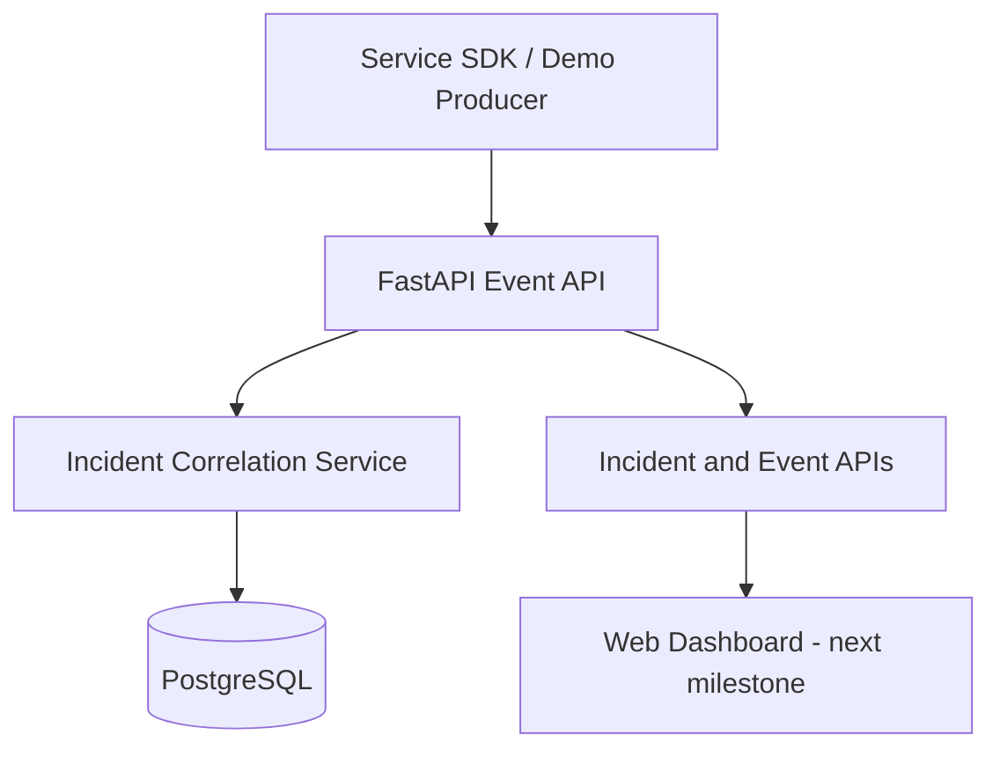

# OpsPilot Architecture (MVP)

## Current vertical slice

OpsPilot starts as a modular monolith with one API process and a relational database. This keeps local development and testing straightforward while leaving clear seams for background workers and message brokers later.

## Event ingestion

1. Validate the event envelope with Pydantic.
2. Persist every accepted event, including informational events.
3. For warning, error, and critical events, compute a stable fingerprint from service, event type, and normalized message.
4. Create an incident if no matching fingerprint exists. A uniqueness constraint protects the fingerprint against duplicate incidents.
5. Attach subsequent matching events to the same incident and increment its occurrence count.
6. Escalate priority when a more severe matching event arrives.

## Initial priority and response targets

| Severity | Priority | Initial response target |
|---|---|---|
| Critical | P1 | 15 minutes |
| Error | P2 | 30 minutes |
| Warning | P3 | 4 hours |
| Info | No incident | Not applicable |

These are demonstration defaults and should be configurable per organization in a later release.

## Incident lifecycle

`open -> acknowledged -> resolved`

A new matching alert reopens a resolved incident. Invalid acknowledgement or repeated resolution attempts return HTTP 409. Every lifecycle action is written to `incident_activities` for an audit trail.

## Planned evolution

- Add tenant-aware authentication and RBAC before exposing the system to external users.
- Add a durable queue and background workers when ingestion volume requires decoupling.
- Add OpenTelemetry collectors and Prometheus metrics for OpsPilot's own service health.
- Add service dependency graph and evidence-backed root-cause suggestions.
- Add dashboard and browser-based end-to-end tests.
